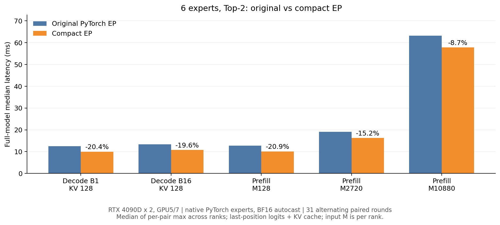

# 六专家Top-2：验收、迁移与EP整模型收益

## 目的
验证独立新模型和两个项目的接入闭环，并公平对照原EP和compact EP。

## 执行方案
6专家Top-2、2 Rank、每Rank3专家，hidden768、8层、专家中间维度2432；RTX4090D物理GPU5/7，PyTorch2.9.0+cu128。FP16导出权重加载为FP32模型参数，BF16 autocast；专家矩阵乘仍使用原PyTorch。

[验收](../doc/ep/design/10_新模型验收.md) · [迁移](../doc/ep/design/11_服务器迁移.md) · [性能](../doc/ep/design/12_6选2EP基线.md)

## 结果
完整模型219个checkpoint张量全部有限、8层×6专家×3投影的NK形状完整。两Rank各585个恢复文件张量有限；epoch=1（从0计）、step=19848、world_size=2，AdamW状态已实际load_state_dict。恢复文件模型值与完整导出的相应子集逐元素相同，共享Embedding/LM Head保持同一参数。未执行优化器更新。

每Rank完成输入长度1/17/128/340的Prefill及一次缓存Decode，输出有限；3个提示各生成16个Token。首轮未加训练BOS时出现单词重复；补齐BOS后恢复连续续写。哈尔滨相关回答仍出现地理错误，这些探针不替代验证集质量评估。

正式文件201份，其中197份是新增或更新；覆盖前逐文件校验，原服务器版本已保留。旧模型、新完整权重及Rank恢复文件的大小和修改时间均未变化。

my_cuda_kernels以editable包安装在服务器同级项目目录，模型使用普通import。已有GCC12和nvcc编译EP库，通过动态加载；通用包3项、模型5项CPU检查全部通过。迁移后original/compact分别与首轮参考比较，4组Prefill、4组缓存Decode及3组16步生成均逐元素/逐Token相同；带BOS的original/compact探针也相同，两Rankcompact回退为0。

6专家Top-2、2 Rank、每Rank3专家，hidden768、8层、专家中间维度2432；RTX4090D物理GPU5/7，PyTorch2.9.0+cu128。FP16导出权重加载为FP32模型参数，BF16 autocast；专家矩阵乘仍使用原PyTorch。

| 场景 | Original ms | Compact ms | 耗时下降 | 峰值显存 Original / Compact GiB |
| --- | ---: | ---: | ---: | ---: |
| Decode B1 | 12.522 | 9.966 | 20.41% | 0.894 / 0.895 |
| Decode B16 | 13.342 | 10.725 | 19.62% | 0.962 / 0.965 |
| Prefill M128 | 12.726 | 10.069 | 20.88% | 0.898 / 0.917 |
| Prefill M2720 | 19.129 | 16.220 | 15.21% | 1.047 / 1.400 |
| Prefill M10880 | 63.261 | 57.788 | 8.65% | 1.511 / 2.955 |

5组隐藏状态和logits均完全相同。每组8次预热、31轮original/compact交替测量，先对同轮两Rank取较大值，再取中位数；同步CUDA，前置barrier不计入耗时。GPU占用监测20次，仅有本次测量进程，compact非预期回退为0。

M是每Rank输入Token数；Top-2展开后的专家行数动态分配。Decode是KV上下文128下的一次next-token前向；Prefill和Decode均保留KV，仅输出最后位置logits。模型推理未启用torch.compile，两种路径一致；本轮是整模型EP收益，不是单GEMM或编译收益。

显存为单Rank的PyTorch峰值allocated，取两Rank较大值，不是nvidia-smi总占用。M10880的compact工作区最大约1.592GiB，说明提速伴随工作区占用代价。

## 调整闭环
首轮生成探针漏加训练使用的BOS，补测输入格式后单词重复消失；不能据缺BOS的探针断定训练失败。模型存在常识错误，后续单独评估验证集loss和标准生成；本轮不更改权重或训练。

首轮计算/数值对拍完成，但结束统计把主动禁用优化EP的original基线调用计作回退，触发严格断言。已分开记录intentional_original_bypasses和compact非预期回退，保留首轮并完整重测。第二轮两Rank主动基线绕过各1656次，compact真正回退均为0；只使用第二轮作为最终结果。后续若优化大M显存，应单独设计跨层工作区复用并重新对拍/测量；本轮不继续优化算子。
