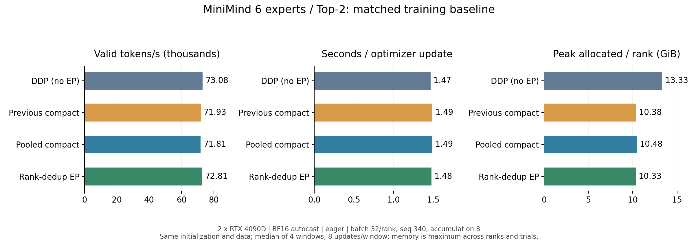
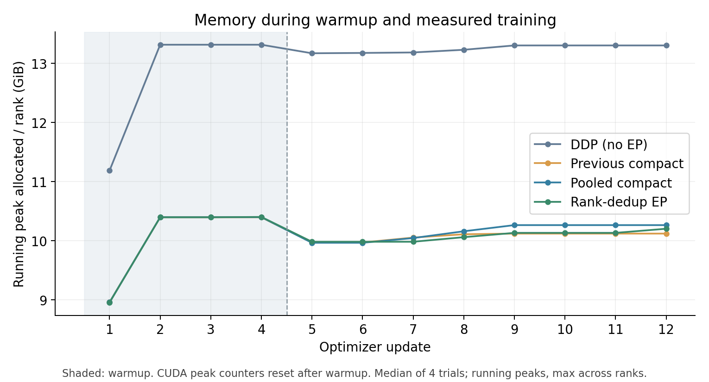

# MiniMind 6专家Top-2：DeepEP机制迁移

## 目的

在保留原PyTorch专家和BF16规则的前提下优化EP，把“同一Token重复派发”与“每层重复缓存”作为具体问题。

## 执行方案

采用每次独立的路由handle，只复用非反向保存的scratch。Top-2按Token/目标Rank去重，接收端直接展开到专家输入；逐专家返回/合并保持原规则。推理层共用同device/stream工作区，最终输出独立。

## 结果

| 方案 | 有效Token/s中位数 | 秒/更新中位数 | 峰值allocated GiB | 峰值reserved GiB |
| --- | ---: | ---: | ---: | ---: |
| 无EP DDP | 73084 | 1.4694 | 13.330 | 14.602 |
| 旧compact | 71926 | 1.4922 | 10.383 | 13.373 |
| 新compact（scratch/推理池） | 71806 | 1.4889 | 10.478 | 13.336 |
| Top-2 Rank去重 | 72813 | 1.4789 | 10.332 | 13.350 |

四轮配对比较，去重版相对旧compact吞吐中位提升0.74%，相对新compact提升1.27%。派发有效行数少17.09%；输出返回未去重，因此这不代表总通信流量下降同样比例。

与无EP DDP吞吐接近；峰值allocated下降22.50%，主要收益是专家/优化器分片。本轮清理与scratch复用没有稳定训练峰值收益。推理缓存：Rank0：58.54→8.09 MiB（下降86.2%）；Rank1：44.97→8.06 MiB（下降82.1%），该比例仅指EP工作区。

条件：两张RTX4090D、GPU5/7、hidden768、8层、6选2、batch32/Rank、seq340、累积8，FP32参数+BF16 autocast；4轮，每轮4个warmup+8个测量更新。计时关闭compile/profile，统计有效移位标签Token。显存取测量区间跨Rank/轮次的最大allocated；曲线是从warmup/测量重置点开始的累计峰值。

55组单算子值/梯度边界、Compute Sanitizer三项、三类精度compile张量测试、两Rank20项边界、FP32梯度/两次更新均通过。完整旧模型三路径的Prefill/Decode及生成逐位一致；16窗口无非有限loss/梯度或训练回退。

## 调整闭环

首次占用监测错误已修复并全量重测。性能收益小，不能据行数减少宣称大幅缩短完整训练；也未证明EP比无EP训练更快。BF16多更新轨迹在旧实现自身重复测量时同样存在差异，质量与严格重复性仍需单独评估。当前以Top-2显式去重路径和通用compact分别服务配置，下一轮再验证可独立工作的通信重叠。

[完整目的、方案、结果与闭环](../doc/ep/results/14_DeepEP优化闭环.md)。
