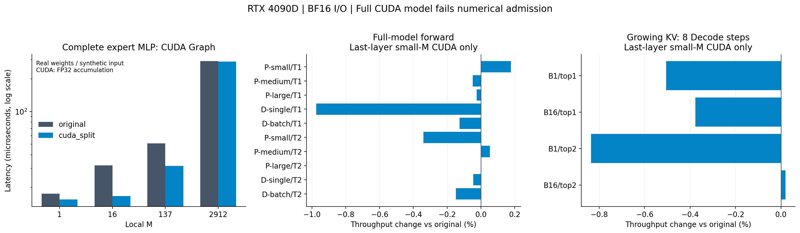

> 历史实验记录：保留该轮配置和结果；当前执行入口见项目 README。

# Prefill/Decode封装与MiniMind-EP接入（2026-10-09）

BF16/FP16输入输出、FP32累加的Prefill/Decode已注册并接入真正EP专家扩展点；默认原模型保持不变。单算子和完整专家MLP通过FP32参考，但全层CUDA仍未通过原BF16模型数值准入。最后一层local M≤256的选项通过现有模型/生成检查，整体速度基本持平。

## 实现与使用
独立注册`torch.ops.my_cuda_kernels_split.prefill/decode`及out版本；单次kernel读取GPU counts，local M≤256默认Decode，否则Prefill。一次打包连续KN权重，三GEMM保留BF16激活/乘法舍入边界；工作区按stream隔离、容量复用，版本变化时重建。训练和普通no_grad调用使用原专家。输出工作区视图会被下次调用覆盖。接口与限制见[调用说明](../dev/pytorch/README_grouped_split.md)。

支持E=1～16，(K,N)=(768,2432)/(2432,768)/(1024,1024)。Graph/compile验证针对算子和本地MLP，整个动态EP尚未支持全链路Graph。KN/NK按专家id保持顺序，原模型权重键不因注册后端增加。

## 数值与安全
接口100项通过，补充显式Decode/out opcheck、动态compile 256/257切换通过；memcheck7场景无错误。最终100真实MLP包含300投影全输出FP32检查及CPU double抽查，完整FP32链bad=0。原默认BF16另有3个完整MLP超过原门槛。

双卡60个完整模型对照中，native的20个逐位一致；last-layer的20个通过`abs_error≤0.02+0.02*abs(ref)`且relative RMS≤0.005，下一token不变，8步greedy全部样本无token变化。全层CUDA20个对照数值未准入，rank1的3处下一token变化、8步greedy另有rank0的一处变化，不能默认启用。480隔离EP是诊断对照，36边界对照验证原路由与FP32目标；训练回退梯度与原实现逐位一致。

NK/KN对应后端logits/KV逐位一致（144 rank Decode步骤）；实际eval入口32组合覆盖双Rank、BF16、Top1/2、NK/KN和4后端。CLI的BF16参数加载单独验证；下面整体基线沿用FP32参数+BF16 autocast，二者不混合计时。

## 封装成本：同一kernel，Graph
RTX4090D，BF16，热缓存，64节点，7轮轮换×10重放。这里原生对照是同CUDA kernel的native bridge，检验封装成本，不是额外开源性能基准。CUDA核心与此前CUTLASS对照版本保持相同。

| 场景 | 同 kernel 原生调用 Graph μs | 工作区 API Graph μs | 分配 API Graph μs |
| --- | ---: | ---: | ---: |
| decode_single_down | 5.0032 | 5.0096 | 5.0032 |
| decode_batch_gate_up | 5.2720 | 5.2784 | 5.2768 |
| decode_137_gate_up | 8.2016 | 8.2080 | 8.2032 |
| prefill_medium_down | 91.7248 | 92.2336 | 91.7584 |
| prefill_large_gate_up | 620.6960 | 621.0528 | 620.6704 |
| regression_2048 | 47.5520 | 47.3920 | 47.5472 |

M137工作区接口较原生调用约0.08%差异；eager含Python提交空隙，不能当作纯kernel时间。

## 完整MLP
真实checkpoint权重、合成BF16输入，E=2，hidden768/intermediate2432；Graph32节点、7轮×10重放，eager64调用/轮。原模块沿用默认BF16归约，新CUDA采用FP32累加，数值契约不同。

| local M / counts | 原 MLP Graph μs | CUDA MLP Graph μs | 原 MLP eager μs | CUDA MLP eager μs |
| --- | ---: | ---: | ---: | ---: |
| 1 / [0, 1] | 17.530 | 15.526 | 57.114 | 60.067 |
| 16 / [8, 8] | 31.914 | 16.694 | 111.120 | 59.635 |
| 137 / [64, 73] | 50.886 | 31.667 | 115.616 | 55.897 |
| 2912 / [1480, 1432] | 290.906 | 287.782 | 298.487 | 292.444 |

M137 Graph延迟降低37.77%，eager降低51.65%。M1的eager反而略慢。不能将这些合成输入MLP数字代替真实全模型结果。

## 模型与EP整体
RTX4090D双卡4/5、8层/4专家、每Rank2专家、native All-to-All、原checkpoint。与基线相同真实输入，每后端60次、5轮轮换，先逐样本取慢Rank wall再统计中位数；不使用Graph。R15的106次GPU监控只见两个测试Rank，频率未锁定。最后一层小M仅在局部完整EP受益；模型基本持平。

| 输入 / Top-K | 原实现 ms | 原数值兼容 ms | 最后一层小 M CUDA ms |
| --- | ---: | ---: | ---: |
| prefill_small_top1 | 11.617 | 11.651 | 11.596 |
| prefill_medium_top1 | 12.883 | 12.884 | 12.889 |
| prefill_large_top1 | 35.742 | 35.742 | 35.751 |
| decode_single_top1 | 11.489 | 11.589 | 11.602 |
| decode_batch_top1 | 12.295 | 12.371 | 12.310 |
| prefill_small_top2 | 11.595 | 11.653 | 11.634 |
| prefill_medium_top2 | 18.207 | 18.199 | 18.198 |
| prefill_large_top2 | 57.738 | 57.741 | 57.737 |
| decode_single_top2 | 11.936 | 11.965 | 11.941 |
| decode_batch_top2 | 12.467 | 12.510 | 12.486 |

增长KV：每样本8个Decode步骤、20样本，context从128起，含argmax与cache增长：

| Top-K / batch | 原实现 ms | 最后一层小 M CUDA ms |
| --- | ---: | ---: |
| 1 / 1 | 92.313 | 92.781 |
| 1 / 16 | 98.848 | 99.221 |
| 2 / 1 | 95.156 | 95.958 |
| 2 / 16 | 100.235 | 100.215 |

全层CUDA尚未数值准入，以下只作实验诊断：

| 输入 / Top-K | 原实现 ms | 全层 CUDA ms（数值未准入） |
| --- | ---: | ---: |
| prefill_small_top1 | 11.617 | 11.231 |
| prefill_medium_top1 | 12.883 | 12.599 |
| prefill_large_top1 | 35.742 | 36.814 |
| decode_single_top1 | 11.489 | 11.686 |
| decode_batch_top1 | 12.295 | 11.997 |
| prefill_small_top2 | 11.595 | 11.367 |
| prefill_medium_top2 | 18.207 | 19.253 |
| prefill_large_top2 | 57.738 | 58.378 |
| decode_single_top2 | 11.936 | 11.784 |
| decode_batch_top2 | 12.467 | 12.092 |

## 闭环与结论
优化依次处理版本检查、容量复用、独立stream缓冲区和空Rank缓存准备。封装没有明显增加纯kernel时间，MLP性能收益可观；模型整体仍受路由准备、CPU同步、Python提交和EP通信影响。保留原模型默认与原数值兼容选项；最后一层小M通过当前测试，不能推断任意数据均等价。下一步先解决全层BF16契约，再减少路由元数据同步和Python调用。未重新训练，现有算子只实现前向。
