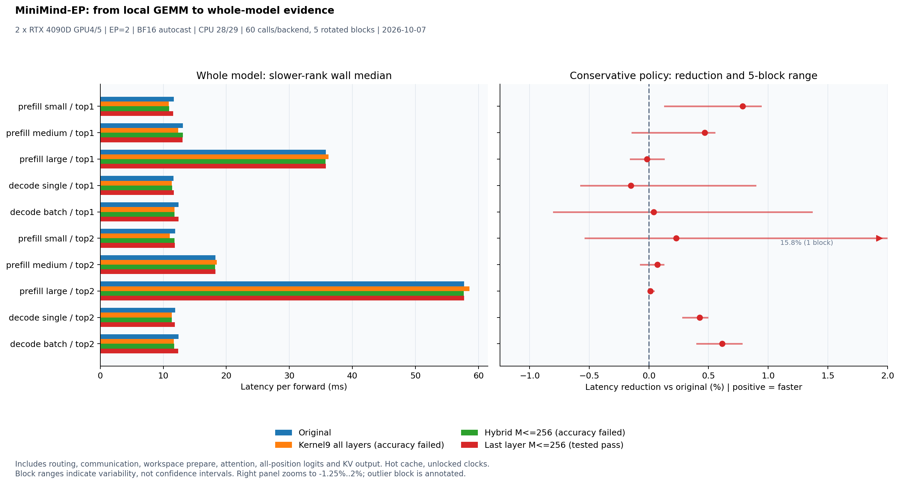

> 历史实验记录：保留该轮配置和结果；当前执行入口见项目 README。

# MiniMind-EP：Grouped GEMM 接入与整体模型评估

2026年10月7日，双卡EP接入、数值传播审计及模型/EP/连续Decode同轮性能评估完成。全层kernel9与hybrid没有通过模型兼容性门槛；最后一层小M策略通过已测输入的标准，整体收益主要是部分静态小场景约0.x%，连续Decode基本持平或略慢。默认保持original。

## 从问题到接入

原模型已把Token按本地专家分组，专家段仍逐专家运行3个投影。新适配器保留原路由、dispatch/combine、逆置换，只替换专家段；将GPU counts直接交给kernel9，在前向中按实际M准备工作区，缓存权重并保留原激活的BF16舍入边界。训练与inference_mode外走原实现，训练时失效缓存。

2026年10月7日，Server-Internet，GPU4/5 两张 RTX 4090D、EP=2；互联 NODE，无 NVLink，CPU Rank0/1 固定到 28/29（NUMA1）。TileLang venv Python 3.13.5、torch 2.9.0+cu128；BF16 autocast、FP32 参数与 GEMM 累加，TF32 关闭，native EP 通信。沿用原 checkpoint / 模型 snapshot 和输入构造；top2 为原 top1 checkpoint 的路由压力实验。

五个负载均为每 Rank：Prefill B1×128 / B8×340 / B32×340；Decode B1×1 / B16×1，固定原 128-token KV 快照；top1/top2 共 10 场景。Prefill / 固定 Decode 保留全部位置 logits 与新 KV 输出，不包含 tokenizer、采样和持续调度。

四条路径：original；全层 kernel9；hybrid（本地总 M≤256 才用 kernel9）；last_layer（仅最后一层且本地 M≤256）。256 是阶段 05 小 M 结果形成的本次候选策略，未宣称适用于所有模型/形状。默认 original。

## 数值验证决定后端范围

严格标准沿用阶段 05：逐元素 atol=0.02 / rtol=0.02，同时相对 RMS≤0.5%。原模型重复执行、带审计执行位级一致，输入与基线逐元素一致、counts 与原采集相同。路由变化按每层每 Token 的专家集合比较，topk 的顺序变化不作为专家集合变化。

| 后端 | logits 严格通过 | 最大相对 RMS | 路由变化 Token-层次数 | 固定输入下一 token 变化 | 自建 KV 生成变化 |
| --- | ---: | ---: | ---: | ---: | ---: |
| kernel9 | 0/20 | 5.1442% | 2905 | 3 | 2/160 |
| hybrid | 8/20 | 5.1442% | 51 | 0 | 2/160 |
| last_layer | 20/20 | 0.1785% | 0 | 0 | 0/160 |

以上路由数字是 Token-层观察次数，不是唯一 Token 数。全层 kernel9 的 logits 相对 RMS 最高 5.1442%，固定输入下一 token 有 3 次变化；hybrid 的中/大 Prefill 回退原实现，可通过 8/20，但小场景仍不满足标准。两者自建 KV 的 160 个生成 token 均有 2 个变化。

last_layer 的中/大 M 回退保持原输出，小 M 则只修改最后一次专家计算，避免影响后续层的路由。20/20 Rank-场景通过，最大 logits 相对 RMS 0.1785%、逐元素超阈值 0、路由变化 0；自建 KV 的 B1/B4、top1/top2、8 步合计 160 个 token 全部一致。另以 B16 / 原 KV 起点测试 32 次逐步 logits、512 个采样 token，也全部通过/一致。这些是有限样本验证，不表示任意输入下都与原模型等价。

同输入隔离 EP 回放共 10场景×8层×2Rank×3后端=480 次：kernel9 / hybrid / last_layer 对原 BF16 输出严格标准分别 151/160、157/160、158/160；路由专家与 counts 全部一致，所有相对 RMS≤0.5%。未把局部的逐元素失败写成全部通过。

6类人工路由×2Rank×3后端=36 次边界检查，覆盖零接收Rank、同Rank top2、跨Rank top2、偏斜/尾块、某Rank零源输入；分配数守恒、专家顺序和输出形状均通过，完整 FP32 舍入链 EP 参考 36/36 通过。对原 BF16 逐元素+相对RMS标准为21/36，其中低幅值输入的相对误差超限保留记录。训练回退两 Rank 的实际 forward/backward、输入梯度和有梯度参数均 bitwise 一致，训练调用清理对应缓存。

## 模型前向结果

正式模型和第7层完整EP：每后端预热20次，5轮轮换，每轮12次，合计60次；切换后端后再预热3次以恢复各自稳态。barrier与计时前同步在区间外，区间为开始Event/墙钟→实际forward→结束Event同步；先按同编号样本取两Rank较慢的wall time，再计算中位数与P95。Event区间含CPU提交空隙，单独保留；不将GPU Event当作纯计算时间。

模型区间包括路由、count exchange、dispatch、原专家或kernel9、元数据、激活、形状变化prepare、combine、attention、全部logits和新KV构建。权重缓存初始化在计时外，2Rank分别8.197/8.066ms；本测量初始化了8层cache，每Rank约171MiB。另记录每场景首次清空工作区的单次前向，不能把单点当分布。

增长KV：从相同原模型128-token KV与首token起点，连续8步，包含argmax与KV推进、logits_to_keep=1，5轮轮换×4块=20个8步块/后端；不含prefix prefill。其算法范围与固定Decode不同，分别呈现。整模型CUDA Graph没有尝试，动态EP已有CPU splits，不宣称可以直接捕获。

| 场景 | 原实现中位 / P95 | last_layer 中位 / P95 | 延迟减少 |
| --- | ---: | ---: | ---: |
| prefill_small_top1 | 11.681 / 12.364 | 11.589 / 12.516 | +0.785% |
| prefill_medium_top1 | 13.104 / 14.051 | 13.043 / 13.996 | +0.468% |
| prefill_large_top1 | 35.772 / 35.909 | 35.777 / 36.004 | -0.015% |
| decode_single_top1 | 11.646 / 12.396 | 11.663 / 12.667 | -0.152% |
| decode_batch_top1 | 12.418 / 13.549 | 12.413 / 13.693 | +0.039% |
| prefill_small_top2 | 11.884 / 15.115 | 11.856 / 13.075 | +0.230% |
| prefill_medium_top2 | 18.283 / 18.619 | 18.270 / 18.575 | +0.071% |
| prefill_large_top2 | 57.717 / 57.822 | 57.711 / 57.811 | +0.012% |
| decode_single_top2 | 11.896 / 12.843 | 11.846 / 12.732 | +0.426% |
| decode_batch_top2 | 12.417 / 13.305 | 12.341 / 13.258 | +0.613% |

增长KV，单位为8步块的ms：

| 场景 | 原实现中位 / P95 | last_layer 中位 / P95 | 延迟减少 |
| --- | ---: | ---: | ---: |
| top1 B=1，8 步 | 91.850 / 92.237 | 92.270 / 92.938 | -0.456% |
| top1 B=16，8 步 | 99.204 / 99.366 | 99.392 / 99.614 | -0.189% |
| top2 B=1，8 步 | 95.460 / 98.307 | 95.652 / 95.903 | -0.201% |
| top2 B=16，8 步 | 99.693 / 101.376 | 99.664 / 100.414 | +0.028% |



## 结果解释与闭环

首轮 last_layer 固定前向的延迟变化为 -0.152%～+0.785%，独立复测为 -0.273%～+0.890%。小 Prefill top1 的 0.785%→0.890%，单条 Decode top2 的 0.426%→0.373%，批量 Decode top2 的 0.613%→0.540%，在两窗口有小幅收益；top1 单条 Decode 两轮均略慢。批量 top1 的两轮结果由 +0.039% 到 +0.637%，块间也跨零，不做稳定加速承诺。

全层 kernel9 有些静态前向约快 2.4%～7.1%，大 Prefill 约慢1.0%～1.5%；它没有通过模型数值门槛，速度只能作为诊断，不作为可用性能收益。hybrid 的小 M 效果也因数值失败而不准入。

增长 KV 的 last_layer 8步块耗时变化为 -0.456% / -0.189% / -0.201% / +0.028%（top1 B1/B16、top2 B1/B16）。20个块中每Rank分别发生160 / 160 / 120 / 140次工作区 prepare，均在前向内计时；不能拿稳态无prepare的微基准推断连续 Decode。

独立 profiler 的 Decode B16 top1 / Rank0，8层专家区域 CPU inclusive 时间 original 2.521ms、全量kernel9 0.953ms、last_layer 2.353ms；对应 GPU duration sums 0.413 / 0.369 / 0.408ms。路由CPU约1.696ms、dispatch约1.402ms、combine约1.039ms，计数拆分/计数统计和排序也保留。区域含 profiler、提交与等待，不是正式模型时间分解；NCCL GPU duration 含等待，不能看作纯链路传输。

分组专家路径省掉的是本地 counts.tolist，send/recv splits 的 CPU 同步仍在；PyTorch bincount 本身也可能在其动态输出处理中同步。代码没有改变路由/通信算法，不能仅凭 GEMM 优化消除这些开销。safe策略只覆盖1/8层，收益上限进一步缩小。

R01 的 prefill_small_top2 某个轮换块出现 +15.785% 的相对变化，而总中位数只有+0.230%；该异常波动保留，图中单独标注。两轮正式GPU占用采样未发现其它计算进程共用GPU4/5，整台服务器仍有其他GPU任务、频率未锁定；不能把小幅比例泛化为稳定吞吐承诺。

当前项目闭环为：独立算子正确性/开源对照→可调用API→真实MLP→模型误差传播→保守接入→整体计时与复测。局部MLP最高60.9%的延迟减少没有直接变成模型级收益，数值门槛限制了覆盖范围，动态prepare和EP提交/同步限制了连续Decode效果。

后续优先按容量复用工作区，再测增长KV；评估counts/排序及同步/通信；对全层接入先制定并验证低精度与路由稳定性方案。当前数据不足以支持新算子反向、整模型Graph或任意输入的等价性结论。

## 调用与缓存约定

当前适配器绑定本次 MiniMind forward snapshot；更换模型版本后需重新核对语句结构。先完成分布式初始化、checkpoint加载和eval，加载阶段04构建的扩展，再安装适配器：

```python
from grouped_gemm_api import load_library
from minimind_ep_backend import MiniMindEPBackend
load_library(extension_path)
backend = MiniMindEPBackend(model, backend='original', threshold=256)
backend.initialize()  # 一次性权重准备；当前入口准备8层
backend.backend = 'last_layer'
with torch.inference_mode(), torch.autocast('cuda', dtype=torch.bfloat16):
    output = model(input_ids, past_key_values=cache, use_cache=True)
backend.backend = 'original'
```

加载或原位更新专家权重后显式调用 `backend.invalidate(reason='weights changed')`，再initialize或在下次专家调用重建；设备、精度、专家映射变化同样要重建。工作区每模型只支持一次并发调用，多个stream需要独立实例。训练会自动回退原方法并失效对应cache，回退检查不表示kernel9实现了反向。
