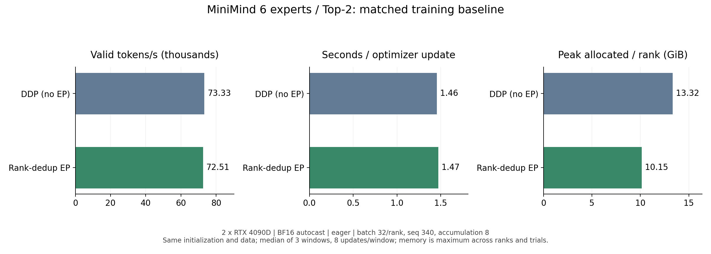
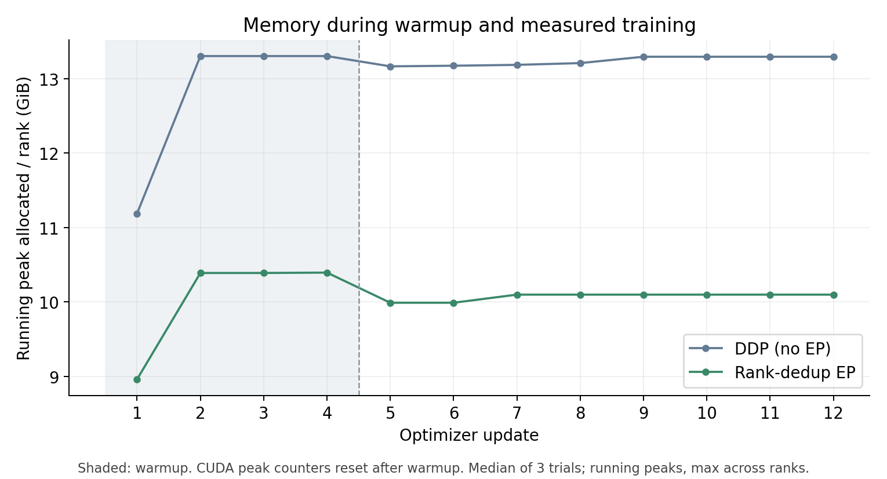

# MiniMind Expert Parallel（EP）

在原 MiniMind MoE 上增加专家并行：每个 Rank 保存一部分专家，共享参数在各 Rank 保持一致，通过 All-to-All 派发 Token 并返回专家输出。目标是在相同模型和训练条件下减少每张卡的专家参数、梯度与优化器状态占用，并测量通信带来的吞吐影响。

原项目介绍、数据准备和基础用法见 [README](README.md)。代码改动以首次 EP 提交前的 `89d674b` 为基准；默认关闭 EP，专家数和 Top-K 默认仍为 4 / 1。

## 实现与适用范围

| 配置 | 行为 | 依赖 |
| --- | --- | --- |
| 不指定 `--use_ep` | 原模型单卡 / DDP 路径 | 原项目依赖 |
| `--use_ep --ep_routing original` | 原生 PyTorch 专家路由与通信 | PyTorch 分布式 |
| `--use_ep --ep_routing compact` | CUDA 分组、打包、合并；训练 scratch 与推理工作区复用 | `my_cuda_kernels` EP 库 |
| `--use_ep --ep_routing dedup_train` | Top-2 按 Token / 目标 Rank 去重派发，接收端直接展开 | 同上，Top-K 必须为 2 |

专家总数须被 EP Rank 数整除，`1 ≤ Top-K ≤ 专家总数`。当前为连续、均匀的专家分片；优化路由要求 CUDA 和 `native` 通信。输入支持 FP32、FP16、BF16，专家计算仍使用原 PyTorch 模块及 autocast 规则。

优化路径保留 Router 的 softmax / Top-K，以及逐专家返回、权重乘法和合并时的 BF16 舍入顺序。去重主要减少输入派发及对应反向传输，输出仍按专家分配返回。每次前向重新计算路由；反向使用的映射属于本次前向，缓冲区复用只缓存空间。

计数交换附带完整专家分配数，直接推导本地专家切片，省掉专家分组后的 CPU 读数；计数异步复制到可复用的固定页缓冲，与打包重叠。仍需在使用动态 NCCL splits 前等待对应 Event，这不是完全无 CPU 同步的路径。

可选回传流水使用统一的逐专家调度：每个专家完成完整 GEMM 后，直接读取输出切片装桶并在通信流回传，同时计算流继续处理下一个专家。没有首专家特殊分支；专家输出超过桶容量时只切分通信，不切分 GEMM。桶计划由全局计数统一决定，同时限制各 Rank 的发送和接收量，空专家无需额外 collective。反向用单一 autograd 节点固定各 Rank 的通信顺序：先提交各桶的输出梯度回传，按专家数据就绪 Event 等待，再执行完整的原 PyTorch 专家反向，与后续桶通信重叠。保留完整 GEMM 的 M 和原 BF16 分支舍入；已消费的专家反向图及时释放。这条流水支持每次前向一次一阶反向，不支持二阶梯度或重复反向。流水默认关闭；是否启用以当前环境的端到端测量为准。

## 安装优化路由依赖

MiniMind 负责模型、NCCL 编排、梯度同步和模型保存；[my_cuda_kernels](https://github.com/snod-tg/fused_residual_rmsnorm_kernel) 提供通用 CUDA 打包、展开、合并及 autograd 算子。两项目通过 Python 包调用关联。

在已具备 CUDA PyTorch 的环境中，进入算子项目构建：

```bash
cd ../my_cuda_kernels
python -m pip install --no-deps --no-build-isolation -e .
python script/build.py ep
cd ../minimind
```

优化路由实测环境：Python 3.13.5、PyTorch 2.9.0+cu128、CUDA Toolkit 12.4、GCC 12、RTX 4090D。编译与运行使用同一 PyTorch 环境；需要指定其他构建时，可传 `--ep_routing_library /absolute/path/my_cuda_ep.so`。

## 训练

数据按原 README 准备。以下命令在 `trainer/` 下运行，示例为双卡、6 专家 Top-2、从头预训练；其余训练参数沿用原入口默认值。每次运行使用独立的输出目录与前缀。

```bash
cd trainer
CUDA_VISIBLE_DEVICES=2,3 OMP_NUM_THREADS=1 TORCHINDUCTOR_COMPILE_THREADS=1 \
python -m torch.distributed.run --standalone --nproc_per_node=2 train_pretrain.py \
  --use_ep --num_experts 6 --num_experts_per_tok 2 \
  --ep_comm_dtype native --ep_routing dedup_train --use_compile 1 \
  --from_weight none --from_resume 0 \
  --save_weight pretrain_ep6_top2_new \
  --save_dir ../out/ep6_top2_new --checkpoint_dir ../checkpoints/ep6_top2_new
```

长训练可先在项目根目录执行 `tmux new -s ep6_top2_new`，再执行上述训练命令；`Ctrl-b d` 分离，`tmux attach -t ep6_top2_new` 返回。启动前检查 `nvidia-smi`，选择同组内两张空闲卡。

调整专家数 / Top-K 使用对应参数；Top-K 大于 2 时选择 `compact`。全量微调沿用 `trainer/train_full_sft.py --use_ep` 的原生 EP 支持。模型 compile 使用原 `--use_compile` 开关；动态 splits 和专家空分支存在编译边界，不能将其称为完整 EP 的 fullgraph 捕获。

优化预训练默认 `--ep_async_counts 1 --ep_pipelined_return 0 --ep_overlap_grad 0`。测试完整更新重叠时显式指定 `--ep_pipelined_return 1 --ep_return_bucket_mib 16 --ep_overlap_grad 1`；各 Rank 的开关、桶容量和精度必须一致。输出按实际行数发送，不传 padding；4/8/12/16 MiB 容量扫描用于选择当前配置的容量。

训练在优化器更新时同步共享参数梯度：按设备和 dtype 分组，以 `--ep_grad_bucket_mib 16` 为默认桶容量合并 All-Reduce，超大参数单独通信；本地专家梯度只除以 EP Rank 数。全局裁剪批量计算 FP32 范数并缩放梯度，共享参数计一份、专家参数计入各 Rank 的分片。归约顺序可能带来 FP32 末位差异，专家计算与 BF16 autocast 规则保持原样。

可选共享梯度重叠只在最后一次梯度累积前记录就绪 Event，hooks 不发起 NCCL。CPU 提交完整反向后，按固定的反向参数顺序在通信流归约，覆盖 GPU 剩余反向尾部；大块连续梯度直接归约，小桶复用打包空间。继续使用同一通信组，优化器更新前等待全部归约完成。每层和每个微批重新路由，不缓存专家分配。

保存完整 MoE 权重，同时为各 Rank 保存独立前缀的恢复状态；续训须匹配专家数、Top-K 和 EP 拓扑。优化训练条件不满足时显式报错，禁止静默回退。

## 推理与 API

在项目根目录使用原推理入口加载完整 MoE 权重，加载时按 Rank 选择本地专家：

```bash
CUDA_VISIBLE_DEVICES=2,3 python -m torch.distributed.run --standalone --nproc_per_node=2 \
  eval_llm.py --use_ep --num_experts 6 --num_experts_per_tok 2 \
  --save_dir out/ep6_top2_new --weight pretrain_ep6_top2_new --model_dtype bf16
```

该命令使用原生 EP 路由。程序内可为已初始化分布式环境、已加载到 CUDA 的 EP 模型安装优化路由：

```python
from model.ep_routing_backend import attach_ep_routing

controller = attach_ep_routing(model, mode="compact", async_counts=True,
                               pipelined_return=False, return_bucket_bytes=16*1024**2)
# Top-2 也可选 dedup_train；启用回传桶时 pipelined_return=True。
# 推理使用 model.eval()、torch.inference_mode() 和所需的 autocast。
# 训练使用正常的 autograd；CUDA 算子已注册反向。
controller.uninstall()
```

现有 KN 权重和 Grouped GEMM 接入保持为独立可选功能。训练默认使用原 PyTorch 专家；CUDA GEMM 全层替换需独立数值验收。KN 转换工具使用 `python -m scripts.convert_checkpoint_kn --help`。

## 同配置训练对比

两张 RTX 4090D，hidden=768、8 层、6 专家 Top-2；每 Rank batch=32、seq=340、梯度累积=8，AdamW、学习率 5e-4、裁剪 1。FP32 参数和优化器状态，BF16 autocast，原 PyTorch 专家；计时关闭 compile / profile。两方案使用相同初值、输入、辅助损失和每次更新一次的梯度同步。

3 轮交替测量，每轮 4 次预热、8 次正式更新。吞吐统计有效移位标签 Token；吞吐和每次更新时间分别取中位数，峰值显存取测量区间跨 Rank / 轮次的最大值。

| 方案 | 有效 Token/s | 秒 / 更新 | 峰值 allocated / Rank | 峰值 reserved / Rank |
| --- | ---: | ---: | ---: | ---: |
| 无 EP DDP | 73,065 | 1.4489 | 13.329 GiB | 14.574 GiB |
| 最新 Top-2 去重 EP（异步完整计数） | 72,956 | 1.4640 | 10.163 GiB | 13.350 GiB |

EP 吞吐约为 DDP 的 **99.85%**，峰值 allocated 降低 **23.75%**，主要来自专家与优化器分片。同轮当前 EP 对照中，完整异步计数方案的中位吞吐提高 **0.99%**（同轮配对提升中位数 1.24%）。回传流水虽有实际 GPU 重叠，仍略慢于仅优化计数的方案，未作为默认路径。该结果是短训练窗口，排除初始化、预热和保存，不能作为完整两轮训练耗时或模型质量结论；当前也未证明比无 EP DDP 更快。

性能基线使用当前代码的无 EP DDP 路径，统一设为原非 EP 的 `local_topk_sum` 辅助损失。代码兼容检查另外直接读取 `89d674b` 的原模型；两种基线分别对应性能测量和源码回归。正式训练入口继续保留已有辅助损失默认值。





## 验证与限制

整理前的 CUDA 验收包含：55 组单算子值 / 梯度边界、Compute Sanitizer 的 memcheck / racecheck / synccheck、两 Rank 的空输入及 6 / 8 专家边界、FP32 梯度及两次 AdamW 更新、已训练 8 层模型的 Prefill / Decode 与生成对拍。16 个性能窗口无非有限 loss / 梯度或优化 EP 回退。

本次目录整理验证默认非 EP 的 CPU FP32 Dense、MoE Top-1 / Top-2 与 `89d674b` 的输出、损失、梯度逐位一致，并核对最新优化路径的计算逻辑未改变。BF16 多次更新轨迹的严格重复性和模型质量需要独立评估。

梯度优化验收：本地与服务器 CPU 回归各 13 项通过；每 Rank 的 24 类 CUDA 梯度契约与 10 类路由边界通过。两层模型新旧 EP 同步梯度最大差异为 0，范数差异不超过 1.20e-7，两次 AdamW 更新后的参数差异不超过 7.46e-9；两种 EP 也分别通过无 EP DDP 对照。9 个 BF16 性能窗口损失与梯度范数均有限，优化 EP 回退均为 0，选定 GPU 无其他任务混入。

计数 / 回传优化验收：每 Rank 12 类路由边界 × 6 条参考与候选路径通过，含空专家、空来源和不等长输入；6 专家 Top-1/2/3/6 的全模型、BF16 值 / 梯度、推理到训练切换共 164 项检查通过。三种 EP 与 DDP 分别通过 FP32 梯度及两次 AdamW 更新对照；12 个 BF16 性能窗口均有限、零回退、选定 GPU 无外部任务混入。单独 profiler 确认前向专家 GEMM 与回传 NCCL 的区间重叠，反向及整体吞吐不据此推算。

当前动态通信仍有 CPU 读取 counts 的同步，派发和输入梯度回传也存在计算依赖。前向、反向及共享梯度归约的流水并不代表所有通信已被隐藏，收益须以同条件的完整训练更新测量为准。

### 完整训练更新重叠测量（RTX 4080 双卡）

两张驱动报告为 RTX 4080 的 SM89 GPU，PyTorch 2.9.0+cu128 / Python 3.12.3，双向 CUDA P2P 不可用。模型与训练协议同上；以 632756a 的前向回传流水作为旧 EP，同轮比较完整更新，计时关闭 compile / profiler。每次更新包含 8 次微批前后向、梯度同步、裁剪和 AdamW；以下为三轮中位值，显存取跨 Rank / 轮次最大值。

| 方案 | 有效 Token/s | 秒 / 更新 | 峰值 allocated / Rank |
|---|---:|---:|---:|
| 无 EP DDP | 61,419 | 1.7345 | 13.313 GiB |
| 旧 EP（仅前向回传流水） | 49,988 | 2.1346 | 10.304 GiB |
| EP 前向与反向回传流水 | 52,170 | 2.0346 | 10.485 GiB |
| EP 回传流水 + 共享梯度重叠 | 52,371 | 2.0337 | 10.620 GiB |

反向流水相对旧 EP 吞吐提高 **4.36%**；完整组合提高 **4.77%**，达到同轮 DDP 吞吐的 **85.27%**，峰值 allocated 比 DDP 低 **20.23%**。组合比旧 EP 多约 0.316 GiB allocated。共享梯度重叠相对仅反向流水的三轮配对增益为 +0.76%、−0.03%、−0.22%，额外收益尚不稳定，因此保持可选。当前环境建议先显式设置 `--ep_pipelined_return 1 --ep_overlap_grad 0`；完整组合使用 `--ep_overlap_grad 1`，两种桶容量均为 16 MiB。全局默认值保持不变，其他硬件需重新测量。


最终版本本地 22 项检查通过；双卡每 Rank 24 项梯度契约、12 类路由边界及 Top-1/2/3/6 的 82 项配置检查通过。现有 compile 方式的 Top-2 每 Rank 25 项检查通过，动态主机边界仍存在。FP32 两层模型同步梯度最大差 2.2352e-8、两次 AdamW 后参数最大差 2.9404e-6，沿用原阈值。5 个正确性任务及 15 个性能任务成功退出，同轮输入一致，30 份 Rank 性能记录均有限、零回退，GPU 无其他任务混入。

单独时间线采集确认反向专家 GEMM 与回传通信重叠，共享梯度归约与反向尾部也有交集；完整更新的 NCCL / 非通信 Kernel 交集占比为两 Rank 的 20.99% / 20.04%。NCCL 区间含对端等待，交集比例不能当作加速比或关键路径节省量。动态计数、派发和输入梯度回传仍有依赖，尚未完全隐藏整步通信。这是短训练窗口的结果，不代表完整两轮训练时间或模型质量，也不与 RTX 4090D 结果混算。
