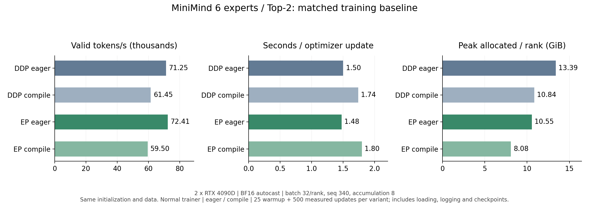

# MiniMind Expert Parallel（EP）

在原 MiniMind MoE 上增加专家并行：每个 Rank 保存一部分专家，共享参数在各 Rank 保持一致，通过 All-to-All 派发 Token 并返回专家输出。目标是在相同模型和训练条件下减少每张卡的专家参数、梯度与优化器状态占用，并测量通信带来的吞吐影响。

原项目介绍、数据准备和基础用法见 [README](README.md)。代码改动以首次 EP 提交前的 `89d674b` 为基准；默认关闭 EP，专家数和 Top-K 默认仍为 4 / 1。

## 实现与适用范围

| 配置 | 行为 | 依赖 |
| --- | --- | --- |
| 不指定 `--use_ep` | 原模型单卡 / DDP 路径 | 原项目依赖 |
| `--use_ep --ep_routing original` | 原生 PyTorch 专家路由与通信 | PyTorch 分布式 |
| `--use_ep --ep_routing compact` | CUDA 分组、打包、合并；训练 scratch 与推理工作区复用 | `my_cuda_kernels` EP 库 |
| `--use_ep --ep_routing dedup_train` | Top-2 按 Token / 目标 Rank 去重派发，接收端直接展开 | 同上，Top-K 必须为 2 |

专家总数须被 EP Rank 数整除，`1 ≤ Top-K ≤ 专家总数`。当前为连续、均匀的专家分片；优化路由要求 CUDA 和 `native` 通信。输入支持 FP32、FP16、BF16，专家计算仍使用原 PyTorch 模块及 autocast 规则。

优化路径保留 Router 的 softmax / Top-K，以及逐专家返回、权重乘法和合并时的 BF16 舍入顺序。去重主要减少输入派发及对应反向传输，输出仍按专家分配返回。每次前向重新计算路由；反向使用的映射属于本次前向，缓冲区复用只缓存空间。

计数交换附带完整专家分配数，直接推导本地专家切片，省掉专家分组后的 CPU 读数；计数异步复制到可复用的固定页缓冲，与打包重叠。仍需在使用动态 NCCL splits 前等待对应 Event，这不是完全无 CPU 同步的路径。

可选回传流水使用统一的逐专家调度：每个专家完成完整 GEMM 后，直接读取输出切片装桶并在通信流回传，同时计算流继续处理下一个专家。没有首专家特殊分支；专家输出超过桶容量时只切分通信，不切分 GEMM。桶计划由全局计数统一决定，同时限制各 Rank 的发送和接收量，空专家无需额外 collective。反向用单一 autograd 节点固定各 Rank 的通信顺序：先提交各桶的输出梯度回传，按专家数据就绪 Event 等待，再执行完整的原 PyTorch 专家反向，与后续桶通信重叠。保留完整 GEMM 的 M 和原 BF16 分支舍入；已消费的专家反向图及时释放。这条流水支持每次前向一次一阶反向，不支持二阶梯度或重复反向。流水默认关闭；是否启用以当前环境的端到端测量为准。

## 安装优化路由依赖

MiniMind 负责模型、NCCL 编排、梯度同步和模型保存；[my_cuda_kernels](https://github.com/snod-tg/my_cuda_kernels) 提供通用 CUDA 打包、展开、合并及 autograd 算子。两项目通过 Python 包调用关联。

在已具备 CUDA PyTorch 的环境中，进入算子项目构建：

```bash
cd ../my_cuda_kernels
python -m pip install --no-deps --no-build-isolation -e .
python script/build.py ep
cd ../minimind
```

优化路由实测环境：Python 3.13.5、PyTorch 2.9.0+cu128、CUDA Toolkit 12.4、GCC 12、RTX 4090D。编译与运行使用同一 PyTorch 环境；需要指定其他构建时，可传 `--ep_routing_library /absolute/path/my_cuda_ep.so`。

## 训练

数据按原 README 准备。以下命令在 `trainer/` 下运行，示例为双卡、6 专家 Top-2、从头预训练；其余训练参数沿用原入口默认值。每次运行使用独立的输出目录与前缀。

```bash
cd trainer
CUDA_VISIBLE_DEVICES=2,3 OMP_NUM_THREADS=1 TORCHINDUCTOR_COMPILE_THREADS=1 \
python -m torch.distributed.run --standalone --nproc_per_node=2 train_pretrain.py \
  --use_ep --num_experts 6 --num_experts_per_tok 2 \
  --ep_comm_dtype native --ep_routing dedup_train --use_compile 0 \
  --ep_pipelined_return 1 --ep_overlap_grad 0 \
  --from_weight none --from_resume 0 \
  --save_weight pretrain_ep6_top2_new \
  --save_dir ../out/ep6_top2_new --checkpoint_dir ../checkpoints/ep6_top2_new
```

长训练可先在项目根目录执行 `tmux new -s ep6_top2_new`，再执行上述训练命令；`Ctrl-b d` 分离，`tmux attach -t ep6_top2_new` 返回。启动前检查 `nvidia-smi`，选择同组内两张空闲卡。

调整专家数 / Top-K 使用对应参数；Top-K 大于 2 时选择 `compact`。全量微调沿用 `trainer/train_full_sft.py --use_ep` 的原生 EP 支持。模型 compile 使用原 `--use_compile` 开关；动态 splits 和专家空分支存在编译边界，不能将其称为完整 EP 的 fullgraph 捕获。

优化预训练默认 `--ep_async_counts 1 --ep_pipelined_return 0 --ep_overlap_grad 0`。本轮实测推荐显式指定 `--ep_pipelined_return 1 --ep_return_bucket_mib 16 --ep_overlap_grad 0`；各 Rank 的开关、桶容量和精度必须一致。输出按实际行数发送，不传 padding。

训练在优化器更新时同步共享参数梯度：按设备和 dtype 分组，以 `--ep_grad_bucket_mib 16` 为默认桶容量合并 All-Reduce，超大参数单独通信；本地专家梯度只除以 EP Rank 数。全局裁剪批量计算 FP32 范数并缩放梯度，共享参数计一份、专家参数计入各 Rank 的分片。归约顺序可能带来 FP32 末位差异，专家计算与 BF16 autocast 规则保持原样。

可选共享梯度重叠只在最后一次梯度累积前记录就绪 Event，hooks 不发起 NCCL。CPU 提交完整反向后，按固定的反向参数顺序在通信流归约，覆盖 GPU 剩余反向尾部；大块连续梯度直接归约，小桶复用打包空间。继续使用同一通信组，优化器更新前等待全部归约完成。每层和每个微批重新路由，不缓存专家分配。

保存完整 MoE 权重，同时为各 Rank 保存独立前缀的恢复状态；续训须匹配专家数、Top-K 和 EP 拓扑。优化训练条件不满足时显式报错，禁止静默回退。

## 推理与 API

在项目根目录使用原推理入口加载完整 MoE 权重，加载时按 Rank 选择本地专家：

```bash
CUDA_VISIBLE_DEVICES=2,3 python -m torch.distributed.run --standalone --nproc_per_node=2 \
  eval_llm.py --use_ep --num_experts 6 --num_experts_per_tok 2 \
  --save_dir out/ep6_top2_new --weight pretrain_ep6_top2_new --model_dtype bf16
```

该命令使用原生 EP 路由。程序内可为已初始化分布式环境、已加载到 CUDA 的 EP 模型安装优化路由：

```python
from model.ep_routing_backend import attach_ep_routing

controller = attach_ep_routing(model, mode="compact", async_counts=True,
                               pipelined_return=False, return_bucket_bytes=16*1024**2)
# Top-2 也可选 dedup_train；启用回传桶时 pipelined_return=True。
# 推理使用 model.eval()、torch.inference_mode() 和所需的 autocast。
# 训练使用正常的 autograd；CUDA 算子已注册反向。
controller.uninstall()
```

现有 KN 权重和 Grouped GEMM 接入保持为独立可选功能。训练默认使用原 PyTorch 专家；CUDA GEMM 全层替换需独立数值验收。KN 转换工具使用 `python -m scripts.convert_checkpoint_kn --help`。

## 基础版与最优版对比

基础版为当前代码的无 EP DDP 路径；非 EP 模型的输出、损失和梯度另与首次 EP 提交前的 `89d674b` 验证一致。本轮优化 EP 采用 Top-2 按 Rank 去重、异步完整计数及前向/反向专家回传流水；关闭收益尚不稳定的共享梯度尾部重叠。对应 `--ep_routing dedup_train --ep_async_counts 1 --ep_pipelined_return 1 --ep_overlap_grad 0`，回传和梯度桶均为 16 MiB。

2026-10-12 在双 RTX 4090D 上使用正式预训练入口比较两版，并各自开启、关闭 compile。hidden=768、8 层、6 专家 Top-2，每 Rank batch=32、seq=340、梯度累积=8；FP32 参数与 AdamW 状态、BF16 autocast、原 PyTorch 专家。Python 3.13.5、PyTorch 2.9.0+cu128、CUDA Toolkit 12.4、GCC 12。

四组共用 FP32 随机初值、逐 Rank 数据顺序与原非 EP 的 `local_topk_sum` 辅助损失，每次优化器更新同步一次梯度。沿用原两轮 cosine 学习率调度，初始学习率 5e-4。每次运行 25 次预热更新加 500 次记录更新，共 4200 microbatch steps；每 1000 steps 及终点保存。每次运行的吞吐与平均更新耗时按预热后整个端到端窗口计算，包含数据加载、前后向、梯度同步、裁剪、AdamW、日志和保存。

此前四组单次测试全部完成。随后启动每组 10 次的重复测试，截至 2026-10-13 已完成 **7 次有效运行**；补跑已取消。下表仅汇总这批重复测试的有效运行，吞吐与更新耗时取运行间中位数，显存取记录窗口跨 Rank、跨有效运行的最大峰值。各组样本数不同，表中中位数不能直接作为同轮配对收益。

| 方案 | 有效次数 / 计划次数 | 有效 Token/s | 秒 / 更新 | 峰值 allocated / Rank | 峰值 reserved / Rank |
|---|---:|---:|---:|---:|---:|
| 基础版：DDP eager | 1 / 10 | 70,365 | 1.5198 | 13.382 GiB | 14.586 GiB |
| 基础版：DDP compile | 2 / 10 | 60,442 | 1.7694 | 10.846 GiB | 11.619 GiB |
| 优化版：EP eager | 2 / 10 | 72,126 | 1.4827 | 10.621 GiB | 14.318 GiB |
| 优化版：EP compile | 2 / 10 | 59,509 | 1.7970 | 8.130 GiB | 11.162 GiB |

EP eager 的吞吐最高。同轮配对比较中，重复测试首轮相对 DDP eager 提高 **2.97%**；此前单轮提高 **1.63%**。两次方向一致，但样本仍少，**尚未证明这一小幅吞吐收益稳定**。第二轮 DDP eager 未完成，不参与配对比较。

EP eager 的峰值 allocated 相对 DDP eager 降低约 **21%**，reserved 降幅较小。allocated 表示 PyTorch 实际分配量，reserved 表示其缓存池预留量，不能将前者的降幅解释为全部显存预留量的降幅。

compile 在两版中均降低显存分配量，但当前配置下端到端吞吐下降。开启 compile 后，EP 相对 DDP 的两轮配对吞吐分别低 **2.83%** 和 **0.23%**。当前性能选择为 EP eager；EP compile 的 allocated 最低，保留为可选配置。EP 动态 counts 仍有 graph break，专家计算可编译，整个 EP 并非 fullgraph。

重复测试的第 8 次运行为第二轮 DDP eager，因其他程序占用选定 GPU 而显存不足中断，未计入有效结果。其余 7 次有效运行均正常退出，loss / 梯度范数有限、优化 EP 回退次数为 0。

下图展示此前四组各一次、每组 500 次记录更新的结果，未合并后续重复测试：



结果适用于当前硬件与配置，不能直接外推完整两轮训练时间或其他专家规模，也未验证训练后模型质量。各次运行均从相同初值独立训练，未覆盖此前训练模型。

## 验证与限制

本轮本地 24 项 CPU 检查通过，服务器同步阶段 23 项检查通过；四种小模型训练入口和四组 500 次记录更新均成功退出，逐 Rank 输入哈希一致、loss / 梯度范数有限、优化 EP 零回退。此前双卡数值与边界验收：双卡每 Rank 24 项梯度契约、12 类路由边界及 Top-1/2/3/6 的 82 项配置检查通过。专家 fullgraph、整模型允许动态边界的 compile 模式下，Top-2 每 Rank 25 项检查通过。FP32 两层模型同步梯度最大差 2.2352e-8，两次 AdamW 后参数最大差 2.9404e-6，沿用原误差阈值。纳入对比的有效运行输入一致，loss / 梯度范数有限、优化 EP 零回退；重复测试中因外部 GPU 占用失败的运行已排除。

动态计数仍有 CPU 等待，派发及输入梯度回传也存在计算依赖，尚未完全隐藏整步通信。共享梯度重叠保持显式可选；训练全局默认仍为回传流水 0、梯度重叠 0，本轮优化版须使用上文列出的开关。当前结果未验证完整训练后的模型质量。
